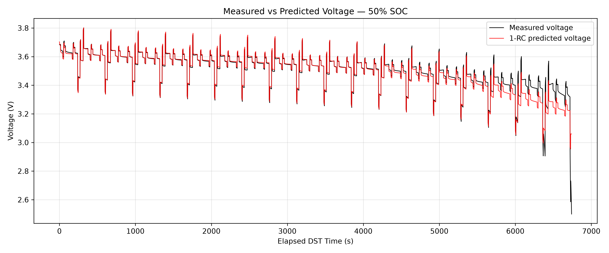
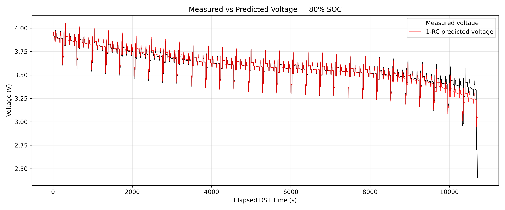
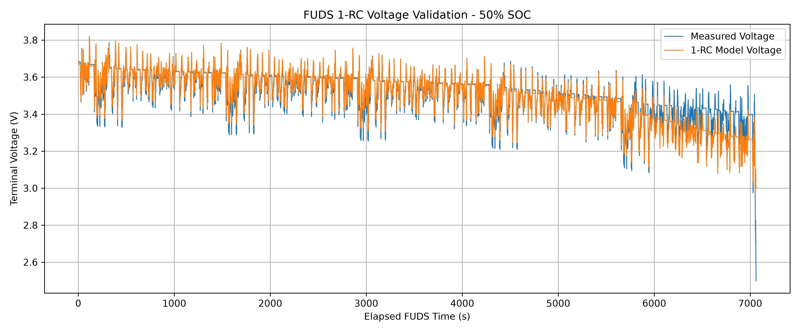
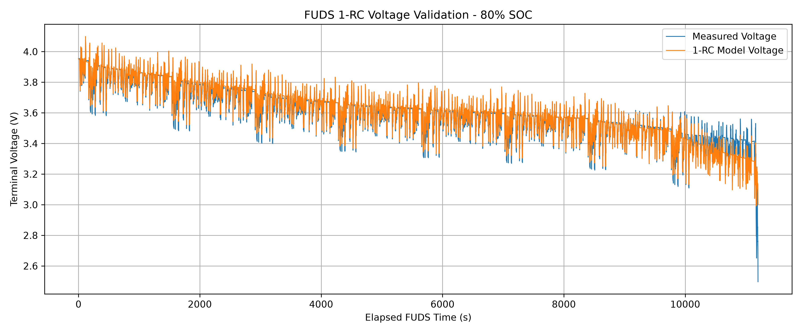
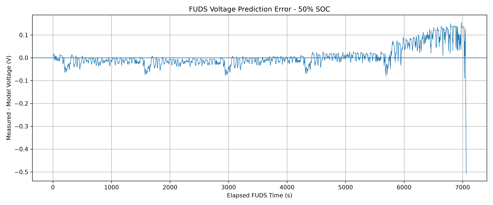
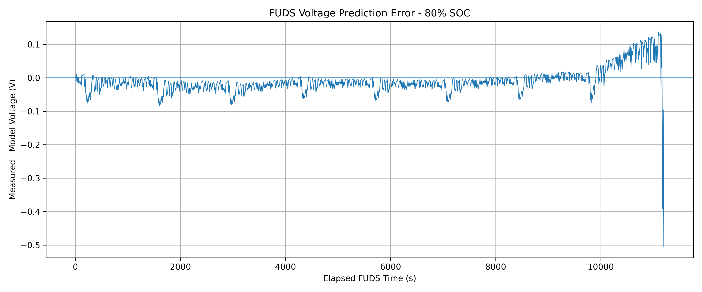

# Fit 1-RC Equivalent Circuit Model and Validate Using Drive-Cycle Experimental Data

## Project Overview

This project focuses on developing a First-Order (1-RC) Equivalent Circuit Model (ECM) for an INR18650-20R lithium-ion battery cell and evaluating its ability to predict terminal-voltage behaviour under dynamic operating conditions.

Experimental data were obtained from the **Center for Advanced Life Cycle Engineering (CALCE), University of Maryland**, at a test temperature of 25°C.

Four experimental datasets are used:

1. Initial Capacity Test
2. Incremental-Current OCV Test
3. Dynamic Stress Test (DST)
4. Federal Urban Driving Schedule (FUDS)

The DST dataset is used for model parameter identification, while the FUDS dataset is used for independent validation.

## Team Members

| Name | Roll Number |
|---|---|
| Pathivada Jayavardhan | 2026CTE2309 |
| Vijay Kumar Singh | 2026CTE2664 |
| Shubham Singh | 2026CTE2814 |

**Faculty Supervisor:** Prof. Saurabh Saxena  
**Teaching Assistant:** Haseeba

## Problem Statement

Lithium-ion battery terminal voltage varies with state of charge (SOC), applied current, internal resistance, and electrochemical polarization. A static battery model cannot adequately represent the transient voltage response under dynamic charge-discharge conditions.

Therefore, this project aims to identify a first-order 1-RC equivalent circuit model using experimental battery data and evaluate its ability to predict terminal voltage under an independent FUDS drive-cycle profile.

## Project Objectives

- Determine the experimental cell capacity using the initial capacity test.
- Calculate SOC and establish the OCV-SOC relationship using incremental-current OCV data.
- Identify the 1-RC equivalent circuit parameters (R0, R1, and C1) using DST experimental data.
- Implement the battery model using measured current as input and OCV as the equilibrium-voltage component.
- Validate the identified model using the FUDS drive-cycle current profile.
- Evaluate prediction accuracy using RMSE, MAE, maximum absolute error, and voltage comparison plots.

## Battery Specifications and Dataset

| Parameter | Description |
|---|---|
| Cell | INR18650-20R |
| Chemistry | Lithium-ion |
| Test Temperature | 25°C |
| Data Source | CALCE, University of Maryland |
| Nominal Capacity Used | 2.00895 Ah |
| Model | First-Order Thevenin 1-RC ECM |

## Experimental Methodology

### 1. Capacity Test

- Determine the usable cell capacity from the constant-current discharge experiment.
- Calculate capacity by integrating discharge current over time.
- Use the measured capacity for subsequent SOC estimation.

\[
Q_n = \frac{1}{3600}\int_0^{t_{\mathrm{end}}}|I(t)|dt
\]

**Calculated capacity:** Approximately 2.009 Ah.

### 2. Incremental-Current OCV Test

- Apply incremental charge/discharge current steps followed by relaxation periods.
- Obtain equilibrium OCV values at different SOC levels.
- Construct the OCV-SOC lookup table using experimental measurements.

\[
OCV=f(SOC)
\]

### 3. DST-Based Parameter Identification

- Extract the dynamic current and voltage profile from the DST experiment.
- Calculate SOC using Coulomb counting.
- Obtain corresponding OCV values using the OCV-SOC lookup table.
- Estimate R0, R1, and the RC time constant using nonlinear least-squares optimization.
- Calculate polarization capacitance using:

\[
C_1=\frac{\tau}{R_1}
\]

### 4. FUDS-Based Model Validation

- Apply the FUDS current profile to the identified 1-RC model.
- Keep DST-identified parameters fixed during validation.
- Predict terminal voltage using the 1-RC model.
- Compare predicted voltage with experimentally measured voltage.
- Evaluate model accuracy using RMSE, MAE, and maximum absolute error.

## 1-RC Equivalent Circuit Model

The first-order Thevenin equivalent circuit consists of:

- **OCV:** Open-circuit voltage source.
- **R0:** Ohmic resistance.
- **R1:** Polarization resistance.
- **C1:** Polarization capacitance.

The terminal voltage model using the CALCE current convention is:

\[
V_t=OCV+I_{\mathrm{CALCE}}R_0-V_1
\]

The polarization dynamics are represented by:

\[
\frac{dV_1}{dt}
=-\frac{V_1}{R_1C_1}
-\frac{I_{\mathrm{CALCE}}}{C_1}
\]

## Repository Structure

```text
Fit-1-RC-ECM-Validate/
│
├── code/
│   ├── DST_code.py
│   └── finding_parameters_DFT_code.py
│
├── dataset/
│   ├── Merged_Channel_1-005.xlsx
│   ├── SP1_25C_IC_OCV_12_2_2015.zip
│   ├── SP1_Initial_capacity_10_16_2015.zip
│   ├── SP2_25C_DST.zip
│   └── SP2_25C_FUDS.zip
│
├── DST_results/
│   ├── DST_1RC_Parameter_Summary.csv
│   ├── DST_50SOC_1RC_TimeSeries.csv
│   ├── DST_50SOC_Current_Voltage.png
│   ├── DST_50SOC_Measured_vs_Predicted.png
│   ├── DST_50SOC_OCV_vs_Time.png
│   ├── DST_50SOC_SOC_vs_Time.png
│   ├── DST_50SOC_Voltage_Error.png
│   ├── DST_80SOC_1RC_TimeSeries.csv
│   ├── DST_80SOC_Current_Voltage.png
│   ├── DST_80SOC_Measured_vs_Predicted.png
│   ├── DST_80SOC_OCV_vs_Time.png
│   ├── DST_80SOC_SOC_vs_Time.png
│   └── DST_80SOC_Voltage_Error.png
│
├── FUDS_results/
│   ├── FUDS_validation_metrics_summary.csv
│   ├── FUDS_50SOC_current.png
│   ├── FUDS_50SOC_error.png
│   ├── FUDS_50SOC_measured_voltage.png
│   ├── FUDS_50SOC_pointwise_results.csv
│   ├── FUDS_50SOC_voltage_comparison.png
│   ├── FUDS_80SOC_current.png
│   ├── FUDS_80SOC_error.png
│   ├── FUDS_80SOC_measured_voltage.png
│   ├── FUDS_80SOC_pointwise_results.csv
│   └── FUDS_80SOC_voltage_comparison.png
│
└── README.md
```

## DST Parameter Identification Results

The 1-RC parameters were identified independently using DST experiments at 50% and 80% initial SOC.

| Parameter | 50% SOC | 80% SOC |
|---|---:|---:|
| R0 (Ω) | 0.07132 | 0.07331 |
| R1 (Ω) | 0.01069 | 0.01814 |
| C1 (F) | 965.04 | 1431.66 |
| Time Constant (s) | 10.31 | 25.97 |

### DST: Measured vs Predicted Voltage

**50% SOC**



**80% SOC**



## FUDS Model Validation Results

The DST-identified parameters were applied to the FUDS experimental data without parameter re-optimization.

### Validation Metrics

| Metric | 50% SOC | 80% SOC |
|---|---:|---:|
| Final SOC (%) | -0.0414 | 0.4845 |
| RMSE (V) | 0.04423 | 0.03718 |
| MAE (V) | 0.02855 | 0.02562 |
| Maximum Absolute Error (V) | 0.50692 | 0.50607 |
| SOC Outside OCV Range (Samples) | 119 | 23 |

### FUDS: Measured vs Predicted Voltage

**50% SOC**



**80% SOC**



### FUDS: Voltage Prediction Error

**50% SOC**



**80% SOC**



## Conclusion

The identified 1-RC equivalent circuit model demonstrated reasonable overall voltage prediction accuracy under the FUDS drive cycle, achieving MAE values of 28.55 mV and 25.62 mV at 50% and 80% initial SOC, respectively.

The results indicate that DST-based parameter identification can capture the dominant dynamic voltage response under an independent driving-cycle profile. However, localized voltage deviations remain and require further investigation.

## Tools and Technologies

- Python
- NumPy
- Pandas
- SciPy
- Matplotlib
- Excel
- CALCE Experimental Battery Dataset

## References

1. CALCE Battery Research Group, University of Maryland – Experimental Lithium-Ion Battery Datasets.
2. G. L. Plett, *Battery Management Systems, Volume I: Battery Modeling*, Artech House, 2015.

---

**Note:** The capacity and OCV-SOC data used in the current implementation are from SP20-1, whereas DST and FUDS data are from SP20-2. This dataset difference should be considered when interpreting the model accuracy.
